<!--
  Profile README for github.com/mustakdx123
  Visual assets live in ./assets (hand-written SVG, no external fonts).
  Local preview: node .preview/build.mjs, then open .preview/index.html
-->

  

  
  
  

  Electronics and Communication Engineering student building where hardware meets software: 
  microcontrollers and sensors on one end, machine-learning models and live dashboards on the other.

 

## About me

- **Studying** — Electronics and Communication Engineering at P.A. College of Engineering
- **Focus** — AI, machine learning, IoT and embedded systems, especially ESP32-based devices
- **How I build** — end to end: sensor → microcontroller → cloud → dashboard
- **Exploring next** — smart health monitoring and AI-based fall detection

 

## Featured projects

**Smart Grain Quality Detection** &nbsp;·&nbsp; `Prototype`

A camera page runs a TensorFlow.js image model directly in the browser every 10 seconds and classifies rice as **Good**, **Bad** or **Wet**. Each result and captured frame is streamed through a Node.js + Socket.IO server to a live dashboard that shows prediction history, a quality-distribution chart, and a moisture graph fed by an HTTP endpoint for sensor readings.

`TensorFlow.js` `JavaScript` `Node.js` `Express` `Socket.IO` `Chart.js` `Render`

[Repository](https://github.com/mustakdx123/Smart-Grain-Quality-Detection-Using-Sensors-and-Image-Analysis-) &nbsp;·&nbsp; [Live demo (camera)](https://smart-grain-analyzer.onrender.com/) &nbsp;·&nbsp; [Live dashboard](https://smart-grain-analyzer.onrender.com/dashboard.html)
 Hosted on Render's free tier, so the first load can take up to a minute while the server wakes up.

  

**Smart Water Desalination System** &nbsp;·&nbsp; `In development`

A small-scale, solar-powered RO water purification prototype. An ESP32 runs the feed pump automatically from float switches, with no-flow, maximum-runtime and float-plausibility safety interlocks and a watchdog. It reads TDS, pH, turbidity and flow sensors, shows live values on a 16×2 LCD, and uploads them to Firebase. A web dashboard displays live values and history graphs, and uses rule-based checks to flag faults and suggest troubleshooting steps.

`ESP32` `Arduino C++` `Firebase Realtime Database` `JavaScript` `Chart.js`

Repository not yet public.

 

## Tech stack

Only tools used in my own project code.

| Area | Tools |
| :-- | :-- |
| **Languages** |     |
| **Embedded & IoT** |   |
| **AI / ML** |  |
| **Web & real-time** |     |
| **Cloud & tools** |     |

 

## Learning goals

What I'm working towards next. These are goals, not finished skills.

| Area | Goal |
| :-- | :-- |
| **AI / ML** | Go beyond running models: collect my own data, then train, evaluate and compare image and sensor models |
| **Edge AI** | Run small ML models directly on ESP32-class microcontrollers so devices can decide without the cloud |
| **Embedded systems** | Strengthen embedded C/C++ fundamentals: RTOS tasks, low-power design and reliable sensor calibration |
| **IoT** | Build secure, reliable device-to-cloud links, including MQTT and over-the-air firmware updates |
| **Software development** | Write cleaner, tested code with TypeScript, automated tests and good Git habits |
| **Real-world projects** | Finish and publish the Smart Water Desalination prototype, then prototype smart health monitoring and AI-based fall detection |

 

## GitHub activity

<b>Show activity cards</b>

 

  
  

These cards come from free third-party services (github-readme-stats and GitHub Readme Streak Stats) and can occasionally fail to load. The contribution graph on this profile page is drawn by GitHub itself.

 

## Connect

  

  

